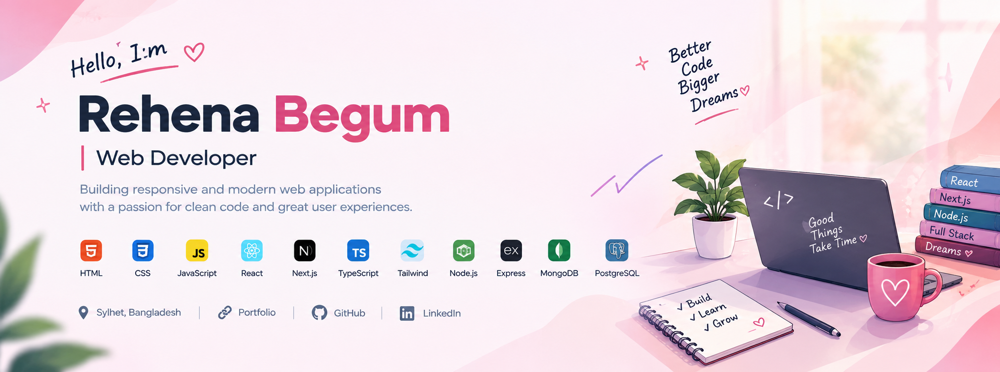

 <!-- ═══════════════ BANNER ═══════════════ -->

  

<h1 align="center">Hey there, I'm Rehena Begum 👋</h1>

<h3 align="center">Web Developer · React.js · Next.js · Node.js</h3>

  
  
  

  <em>Building useful digital experiences, one project at a time.</em>

---

## ✨ About Me

Hi! I'm Rehena, an aspiring Web Developer from Sylhet, Bangladesh. I enjoy turning ideas into responsive, user-friendly web applications and learning how frontend and backend systems work together.

- 💻 Interested in modern frontend and full-stack web development.
- 🚀 Building projects with React.js, Next.js, TypeScript and Node.js.
- 🔌 Working with REST APIs, authentication and database integration.
- 🗄️ Exploring relational and NoSQL databases.
- 🌱 Continuously improving my coding and problem-solving skills.
- 🤝 Open to suitable junior, internship and remote web development opportunities.

🎯 **My goal:** To contribute to real-world projects, learn from experienced developers and grow into a stronger software developer.

---

## 🛠️ Tech Stack & Skills

### 🎨 Frontend Development

  
  
  
  
  
  
  
  

### ⚙️ Backend & API Development

  
  
  
  

### 🗄️ Databases & ORM

  
  
  
  
  

### 🔐 Authentication & Integrations

- JWT-based authentication
- Role-based access control
- Firebase integration
- Third-party REST API integration
- Payment integration with project-specific providers

### 🔧 Tools & Deployment

  
  
  
  
  
  
  
  
  
  

---

## 🚀 Featured Projects

### 🩸 1. BloodLink — Blood Donation & Emergency Assistance Platform

A full-stack platform designed to connect blood donors with people who need blood and support the management of blood requests.

**Key features**
- Role-based authentication and dashboards for donors, recipients and admins.
- Blood request management and donor matching.
- Donor availability and verification workflows.
- Payment integration and receipt management.

**Tech stack:** Next.js · TypeScript · Tailwind CSS · Node.js · Express.js · PostgreSQL · Prisma

🔗 [Live Demo](https://blood-donation-and-emargency-platfo-rho.vercel.app) · [Source Code](https://github.com/Rehenabegum109)

### 🎓 2. ScholarStream — Scholarship Management Platform

A full-stack scholarship management application that helps students explore scholarships, submit applications and track their progress.

**Key features**
- Role-based authentication.
- Scholarship and application management.
- Payment integration.
- Administrative dashboard.

**Tech stack:** React · Node.js · Express.js · MongoDB · Firebase

🔗 [Live Demo](https://illustrious-daffodil-e7692d.netlify.app) · [Source Code](https://github.com/Rehenabegum109/-ScholarStream)

### 🎬 3. Movie Matrix — Movie Discovery Platform

A movie-focused web application for discovering movies and organizing personal watchlists.

**Key features**
- Movie discovery and browsing.
- Watchlist management.
- Reviews and user accounts.
- Subscription-related features.

**Tech stack:** Next.js · Node.js · Express.js · MongoDB

🔗 [Live Demo](https://eg-movie-matrix-collaboration.vercel.app) · [Source Code](https://github.com/Rehenabegum109/movie_matrix)

### ✅ 4. Habit Tracker — Habit Management App

A responsive habit-tracking application designed to help users organize habits and monitor their progress.

**Key features**
- User authentication.
- Create, update and delete habits.
- Habit progress tracking.
- Responsive user interface.

**Tech stack:** React · Node.js · Express.js · MongoDB

🔗 [Live Demo](https://poetic-flan-c66ee4.netlify.app) · [Source Code](https://github.com/Rehenabegum109/habit-tracker-client)

### 🦸 5. Hero Kids App — Hero Management

A full-stack CRUD application for managing superhero-related data through a web interface and backend APIs.

**Key features**
- Create, read, update and delete operations.
- REST API integration.
- Database connectivity.
- Responsive interface.

**Tech stack:** React · Node.js · Express.js · MongoDB

🔗 [Live Demo](https://tubular-moonbeam-b051a7.netlify.app) · [Source Code](https://github.com/Rehenabegum109/Hero-kids-app)

### 👗 6. Luxury Dress Shop — Fashion E-commerce UI

A modern fashion storefront featuring product collections, filtering and shopping cart functionality.

**Key features**
- Product showcase and category filtering.
- Shopping cart interface.
- Responsive design.
- Modern user experience.

**Tech stack:** Next.js · Tailwind CSS · DaisyUI · JavaScript

🔗 [Live Demo](https://dress-store-vert.vercel.app) · [Source Code](https://github.com/Rehenabegum109/shop_dress)

---

## 📊 GitHub Activity

  

  

  

---

## 🌱 Currently Improving

- Advanced React patterns and reusable components
- Next.js App Router
- TypeScript in application development
- Database design and Prisma ORM
- PostgreSQL and API development
- Docker and CI/CD fundamentals

---

## 🌍 Languages

- Bengali — Native
- English — Intermediate

---

## 🤝 Let's Connect

I'm interested in collaborating on web projects, learning from other developers and exploring suitable junior or internship opportunities.

  <a href="https://professional-portfolio-zeta-gray.vercel.app">🌐 Portfolio</a> ·
  <a href="https://www.linkedin.com/in/rehena-begum-057894396">💼 LinkedIn</a> ·
  <a href="https://github.com/Rehenabegum109">🐙 GitHub</a> ·
  <a href="mailto:rehenabegum999000@gmail.com">✉️ Email</a>

  <em>Thanks for visiting my profile! Feel free to explore my projects and connect with me.</em>

  ⭐ Keep learning. Keep building. Keep growing. ⭐

